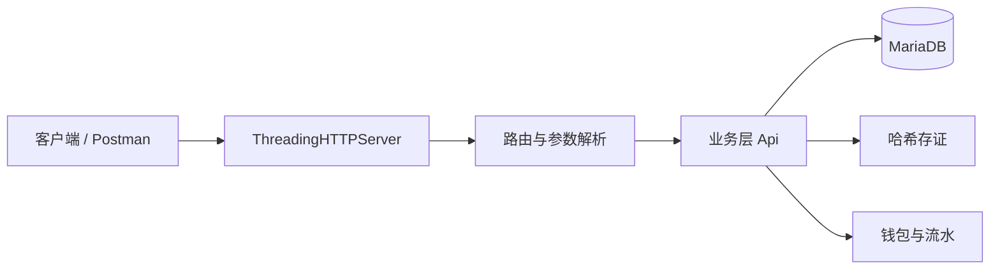
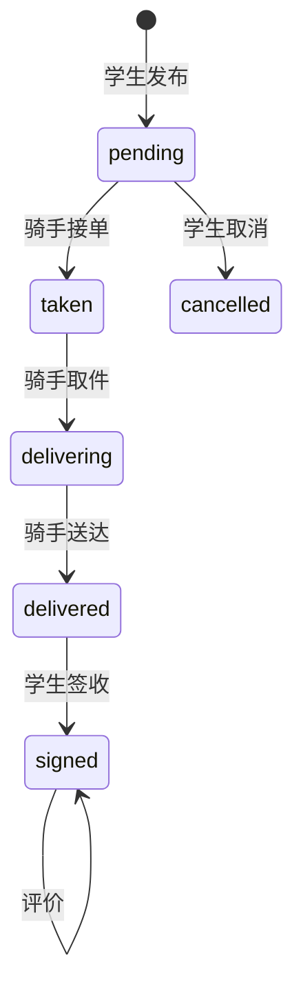

# 校园快递代取平台 · 后端服务


校园快递代取平台是我独立开发的一个后端项目：学生发布代取需求，骑手接单、取件、送达，学生签收并评价；订单每次状态变化都会写入一条哈希存证，出现争议时可以按时间线核对。

我把重点放在后端本身：接口设计、订单状态机、Token 鉴权、钱包与流水、数据库事务和存证链。

## 功能

- 账号：手机号注册、登录、当前用户、资料查看，角色分为学生、骑手、管理员
- 订单：发布、列表、详情、接单、取件、送达、签收、取消、评价
- 钱包：余额、充值、支付、收支流水
- 信用分：签收与评价后的变动记录
- 存证：每个订单节点写入哈希链，提供时间线和校验接口
- 管理：按状态查订单、统计订单数量与金额

## 技术栈

- Python 3.11+
- HTTP 服务：标准库 `ThreadingHTTPServer`，没有引入 Web 框架
- 数据访问：PyMySQL，手写 SQL
- 数据库：MariaDB 10.6 / MySQL 8
- 接口调试：Postman
- 持续集成：GitHub Actions，每次 push 启动 MariaDB 并跑接口自测

为什么不用框架：这个项目想把 HTTP 路由、参数校验、事务和鉴权本身讲清楚，所以服务端只依赖标准库；代价是路由和错误处理要自己写，换来的是部署简单，不装框架也能跑。

## 系统结构



请求处理链路：

1. `Handler._dispatch` 按方法和路径匹配接口；
2. `Api` 负责参数校验、角色判断、订单状态流转；
3. 每个请求创建一个数据库连接，写操作执行完统一 `commit`，异常时回滚并返回错误码；
4. 订单节点更新后调用 `append_chain`，把事件、标题、状态和前一哈希写进 `chain_records`；
5. 响应统一为 `{"code": 0, "message": "ok", "data": ...}`，出错时返回业务错误码和 HTTP 状态码。

## 订单状态



- `pending`：待接单
- `taken`：已接单
- `delivering`：配送中
- `delivered`：已送达
- `signed`：已签收
- `cancelled`：已取消

`expired` 不是数据库状态，而是根据 `created_at + timeout_minutes` 计算出来的展示字段。

## 数据库

库名 `campus_test`，共 6 张表：

| 表 | 作用 | 关键字段 |
| --- | --- | --- |
| `users` | 用户与角色 | `phone`、`password`、`role`、`credit_score`、`wallet_cents` |
| `tokens` | 登录令牌 | `token`、`user_id`、`expires_at` |
| `orders` | 订单主表 | `order_no`、`requester_id`、`courier_id`、`fee_cents`、`status` |
| `chain_records` | 订单存证链 | `order_id`、`event`、`payload`、`prev_hash`、`record_hash` |
| `flows` | 钱包流水 | `user_id`、`type`、`amount_cents`、`ref` |
| `credit_logs` | 信用分变动 | `user_id`、`change_value`、`reason`、`ref` |

金额字段统一存整数分，例如 `8.50` 元存为 `850`，避免浮点误差。详细字段和索引见 [docs/03-数据库设计.md](docs/03-数据库设计.md)。

## 接口

22 个接口，按模块分组：

| 模块 | 方法与路径 | 说明 |
| --- | --- | --- |
| 基础 | `GET /api/health` | 健康检查 |
| 账号 | `POST /api/register` | 注册 |
| 账号 | `POST /api/login` | 登录，返回 Bearer Token |
| 账号 | `GET /api/me` | 当前用户 |
| 账号 | `GET /api/users/{id}` | 查看用户资料 |
| 订单 | `GET /api/orders` | 订单列表，支持状态、范围和分页 |
| 订单 | `POST /api/orders` | 发布订单 |
| 订单 | `GET /api/orders/{id}` | 订单详情 |
| 订单 | `POST /api/orders/{id}/take` | 骑手接单 |
| 订单 | `POST /api/orders/{id}/pickup` | 骑手取件 |
| 订单 | `POST /api/orders/{id}/deliver` | 骑手送达 |
| 订单 | `POST /api/orders/{id}/sign` | 学生签收并扣款 |
| 订单 | `POST /api/orders/{id}/cancel` | 学生取消 |
| 订单 | `POST /api/orders/{id}/review` | 学生评价 |
| 存证 | `GET /api/orders/{id}/timeline` | 存证时间线 |
| 存证 | `GET /api/orders/{id}/verify` | 校验哈希链 |
| 钱包 | `GET /api/wallet` | 余额 |
| 钱包 | `POST /api/wallet/recharge` | 充值 |
| 钱包 | `GET /api/flows` | 收支流水，可按类型过滤 |
| 信用 | `GET /api/credit` | 信用分与变动记录 |
| 管理 | `GET /api/admin/orders` | 管理员查订单 |
| 管理 | `GET /api/admin/stats` | 管理员统计 |

请求示例：

```bash
# 登录
curl -s -X POST http://127.0.0.1:9300/api/login \
  -H 'Content-Type: application/json' \
  -d '{"phone":"13800000001","password":"Stu@123"}'

# 发布订单
curl -s -X POST http://127.0.0.1:9300/api/orders \
  -H "Authorization: Bearer $TOKEN" \
  -H 'Content-Type: application/json' \
  -d '{"title":"取快递","pickup":"菜鸟驿站","dropoff":"3栋201","fee":"8.50","timeout_minutes":30}'
```

完整字段、返回结构和错误码见 [docs/04-接口文档.md](docs/04-接口文档.md)。

## 本地运行

准备数据库：

```sql
CREATE DATABASE campus_test DEFAULT CHARSET utf8mb4;
CREATE USER 'campus'@'127.0.0.1' IDENTIFIED BY 'Campus@123';
GRANT ALL PRIVILEGES ON campus_test.* TO 'campus'@'127.0.0.1';
FLUSH PRIVILEGES;
```

安装依赖并启动：

```bash
pip install -r requirements.txt
python app/server.py --port 9300 --reset
```

`--reset` 会重建表并写入种子账号。启动后检查：

```bash
curl http://127.0.0.1:9300/api/health
```

数据库连接可以通过环境变量覆盖：`DB_HOST`、`DB_PORT`、`DB_USER`、`DB_PASSWORD`、`DB_NAME`。

## 种子账号

| 角色 | 手机号 | 密码 | 初始钱包 |
| --- | --- | --- | --- |
| 管理员 | 13800000000 | Admin@123 | 0 |
| 学生（下单） | 13800000001 | Stu@123 | 300.00 |
| 骑手 A | 13800000002 | Run@123 | 50.00 |
| 骑手 B | 13800000003 | Run@456 | 50.00 |

## 目录

```
app/server.py              服务入口：路由、业务、数据库、存证
tests/                     接口自测脚本
data/order_cases.yaml      下单参数的数据
postman/                   Postman 集合，27 个请求
docs/                      项目说明、系统设计、数据库、接口、部署
requirements.txt           运行依赖
requirements-dev.txt       自测依赖
```

## 设计说明

- **金额统一用整数分**：接口出入参是元，入库和计算用分，返回时再转成两位小数的字符串。
- **Token 存表**：登录时生成 32 位随机 token，有效期 2 小时；每次请求校验 token 和过期时间，不依赖服务端内存。
- **角色控制**：学生只能发布、取消、签收、评价自己的订单；骑手只能接单、取件、送达自己接的订单；管理员可以查全量订单和统计。
- **写操作一个事务**：状态更新、钱包扣款、流水、信用分和存证在同一个连接里提交，异常时回滚。
- **哈希链**：`sha256(prev_hash|order_id|event|title|status)`，每条记录保存前一记录的哈希；校验接口从第一条开始重算，发现不一致就返回断点。

## 当前版本边界

这是课程项目，业务规则做了简化，下面这些是明确还没做的：

- 存证哈希目前只覆盖订单号、事件、标题、状态和前一哈希；金额、取件点、送达点保存在 `payload` 里，但还没进入哈希，后续会把完整 payload 序列化后入哈希；
- 接单入口还没有拦截已经超时的订单，超时只在订单视图里计算展示；
- 签收和评价接口还没有做幂等控制，重复调用会重复扣款或重复加信用分；
- 密码目前是明文存储，生产环境需要改成哈希；
- 服务是单进程 `ThreadingHTTPServer`，生产部署需要换 WSGI/ASGI 服务和反向代理。

## 自测

仓库带一套接口自测，覆盖登录、下单、接单、取件、送达、签收、评价、钱包、存证和数据库核对：

```bash
pip install -r requirements-dev.txt
pytest
```

最近一次本地执行：`108 passed, 5 xfailed in 23.09s`。5 条 `xfail` 对应上面“当前版本边界”里的规则，不是接口跑不通。CI 里会启动 MariaDB 10.6 跑同一套用例。
