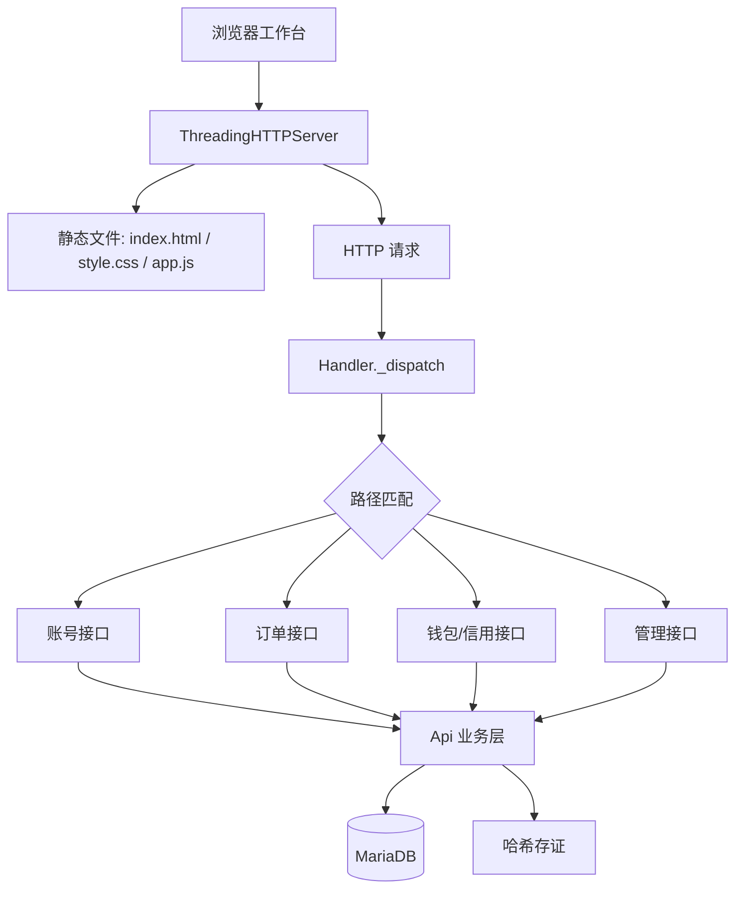
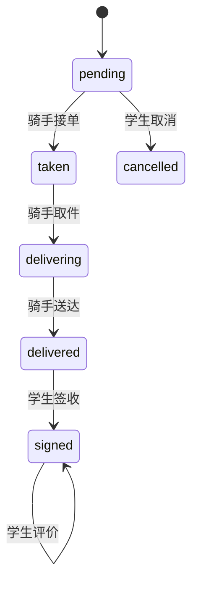

# 系统设计

## 总体结构

服务端是一个单进程多线程的 HTTP 服务，启动入口是 `app/server.py`。页面和接口由同一个进程提供：浏览器打开 `/` 加载工作台，页面里的 JS 再请求 `/api/...`。



### 分层

| 层 | 代码位置 | 职责 |
| --- | --- | --- |
| 页面层 | `web/index.html`、`web/style.css`、`web/app.js` | 登录、工作台、订单详情、钱包、管理统计 |
| HTTP 层 | `Handler` | 返回静态文件，解析方法、路径、请求体，统一返回 JSON |
| 路由层 | `Handler._dispatch` | 匹配 22 个接口，分发到对应方法 |
| 业务层 | `Api` | 参数校验、权限判断、状态流转、事务提交 |
| 数据层 | `connect()` + PyMySQL | 建立连接，执行 SQL，处理游标 |
| 存证 | `append_chain` / `verify_chain` | 写哈希链、校验哈希链 |

`STATIC_FILES` 固定映射首页、样式和脚本，`_send_file` 只读取 `web/` 下的白名单文件，不拼接用户输入路径。

## 请求处理流程

以“骑手接单”为例：

1. 浏览器页面带上 Bearer Token，请求 `POST /api/orders/12/take`；
2. `_dispatch` 匹配到 `take_order(12)`；
3. `current_user()` 解析 token，查出用户和角色；
4. `require_role(user, "courier")` 确认是骑手；
5. 查询订单，判断订单状态、是否本人发布；
6. 更新 `orders` 的 `courier_id`、`status`、`taken_at`；
7. 查回新订单，调用 `append_chain` 写一条 `taken` 存证；
8. `commit` 后返回订单详情，页面刷新订单列表。

访问 `/`、`/style.css`、`/app.js` 时不进入接口路由，直接返回静态文件；`/favicon.ico` 返回 204，避免浏览器反复请求 404。

任一步抛出 `ApiError`，`_dispatch` 捕获后返回业务错误码；其他异常记录堆栈并返回 500。

## 鉴权

- 登录成功后生成 32 位随机 token：`os.urandom(16).hex()`；
- token 和过期时间写入 `tokens` 表，有效期 2 小时；
- 请求头格式：`Authorization: Bearer <token>`；
- 每次请求通过 `tokens JOIN users` 查出用户，校验过期时间；
- 角色控制由 `require_role` 完成，学生、骑手、管理员各自只能调用自己的接口。

Token 存数据库而不是内存，服务重启后已登录用户不会掉线；缺点是每次请求多一次查询，后续可以在 Redis 里加一层缓存。

## 事务

每个请求创建一个数据库连接，`autocommit=False`。

写操作的模式：

```python
with self.conn.cursor() as cur:
    # 更新订单
    # 更新钱包
    # 写流水
    # 写存证
self.conn.commit()
```

出现异常时 `finally` 关闭连接，未提交的事务回滚。这样订单状态、钱包、流水和存证要么一起成功，要么一起失败。

## 订单状态机



状态判断集中在各个业务方法里：

| 操作 | 允许的状态 | 角色 |
| --- | --- | --- |
| 接单 | `pending` | 骑手，且不能接自己的单 |
| 取件 | `taken` | 接单骑手 |
| 送达 | `delivering` | 接单骑手 |
| 签收 | `delivered` | 下单学生 |
| 取消 | `pending` | 下单学生 |
| 评价 | `signed` | 下单学生 |

## 金额

- 外部接口用元，字符串或数字均可；
- `to_cents()` 把元转成整数分，校验最多两位小数；
- 数据库存 `fee_cents`、`wallet_cents`、`amount_cents`；
- 返回时 `to_yuan()` 转成 `"8.50"` 这样的字符串；
- 所有加减法都是整数运算，避免 `0.1 + 0.2` 的浮点问题。

## 哈希存证

`append_chain(order_id, event, order_row)` 的逻辑：

1. 查该订单最后一条存证的 `record_hash`，没有就用 64 个 `0`；
2. 拼接待哈希字符串：`prev_hash|order_id|event|title|status`；
3. 计算 SHA-256，得到 `record_hash`；
4. 把 `event`、`payload`、`prev_hash`、`record_hash` 写入 `chain_records`。

`verify_chain(order_id)` 从第一条开始：

- 检查 `prev_hash` 是否等于上一条的 `record_hash`；
- 重新计算 `record_hash`，和库里比对；
- 最后比对最新存证的 `status`、`title` 和当前订单是否一致；
- 任何一步不一致就返回 `valid=false` 和 `broken_at`。

当前哈希没有覆盖金额等字段，这是已知边界，见 README。

## 错误码

响应格式：

```json
{
  "code": 40902,
  "message": "当前状态不能接单",
  "data": null
}
```

| 错误码 | HTTP | 含义 |
| --- | --- | --- |
| `40001` | 400 | 请求体不是合法 JSON |
| `40002` | 400 | 参数格式不对 |
| `40004` | 400 | 参数超出范围 |
| `40101` | 401 | 未登录 |
| `40102` | 401 | token 格式不对、无效或过期 |
| `40103` | 401 | 手机号或密码错 |
| `40301` | 403 | 没有权限 |
| `40401` | 404 | 资源不存在 |
| `40901` | 409 | 手机号已注册 |
| `40902` | 409 | 当前状态不允许该操作 |
| `40903` | 409 | 余额不足 |
| `50001` | 500 | 服务端异常 |

## 并发和部署

- `ThreadingHTTPServer` 每个请求一个线程，适合课程项目和少量并发；
- 数据库连接不共享，避免线程安全问题；
- 生产环境应该换成 Gunicorn/Uvicorn + Nginx，连接池管理数据库连接；
- 当前没有做限流、幂等和分布式锁，高并发下签收可能重复扣款。

## 目录职责

```
app/server.py        HTTP、静态页面、路由、业务、SQL、存证
web/                 原生 HTML / CSS / JavaScript 工作台
tests/               接口自测与页面静态资源检查
data/                下单参数数据
postman/             接口调试集合
docs/                设计文档与页面截图
```

单文件是为了部署简单，代价是文件比较长。后续如果继续扩展，会把账号、订单、钱包、存证拆成独立模块。
