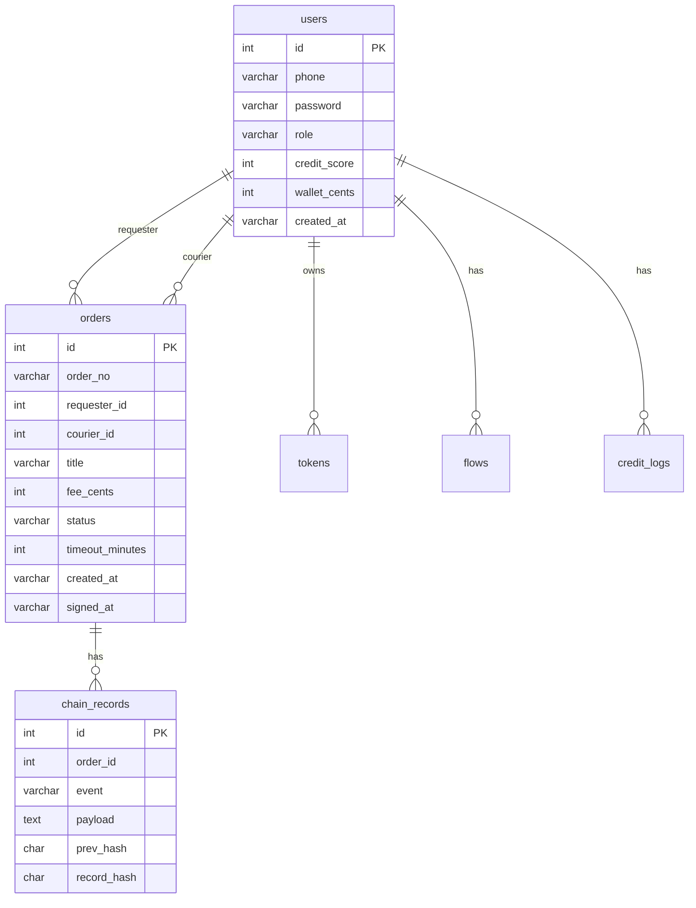

# 数据库设计

数据库使用 MariaDB 10.6，库名 `campus_test`，字符集 `utf8mb4`。建表语句在 `app/server.py` 的 `SCHEMA` 常量里，服务启动时执行 `CREATE TABLE IF NOT EXISTS`。

## 表关系



## users

用户表，学生、骑手、管理员共用。

| 字段 | 类型 | 说明 |
| --- | --- | --- |
| `id` | INT PK AUTO_INCREMENT | 主键 |
| `phone` | VARCHAR(11) UNIQUE | 手机号，登录账号 |
| `password` | VARCHAR(64) | 密码（当前版本明文，后续改哈希） |
| `role` | VARCHAR(16) | `student` / `courier` / `admin` |
| `credit_score` | INT | 信用分，默认 100 |
| `wallet_cents` | INT | 钱包余额，单位分 |
| `created_at` | VARCHAR(32) | 创建时间 |

索引：`phone` 唯一索引，登录时按手机号查。

## tokens

登录令牌表。

| 字段 | 类型 | 说明 |
| --- | --- | --- |
| `token` | CHAR(32) PK | 32 位随机 token |
| `user_id` | INT | 所属用户 |
| `expires_at` | BIGINT | 过期时间，Unix 秒 |

索引：`idx_user(user_id)`，按用户查 token。

## orders

订单主表。

| 字段 | 类型 | 说明 |
| --- | --- | --- |
| `id` | INT PK AUTO_INCREMENT | 主键 |
| `order_no` | VARCHAR(24) UNIQUE | 业务单号，`CX` + 日期 + 6 位随机数 |
| `requester_id` | INT | 下单学生 |
| `courier_id` | INT NULL | 接单骑手 |
| `title` | VARCHAR(40) | 订单标题 |
| `pickup` | VARCHAR(80) | 取件点 |
| `dropoff` | VARCHAR(80) | 送达点 |
| `fee_cents` | INT | 跑腿费，单位分 |
| `status` | VARCHAR(16) | 订单状态 |
| `timeout_minutes` | INT | 超时时间，默认 60 |
| `created_at` | VARCHAR(32) | 创建时间 |
| `taken_at` | VARCHAR(32) NULL | 接单时间 |
| `picked_at` | VARCHAR(32) NULL | 取件时间 |
| `delivered_at` | VARCHAR(32) NULL | 送达时间 |
| `signed_at` | VARCHAR(32) NULL | 签收时间 |
| `cancelled_at` | VARCHAR(32) NULL | 取消时间 |
| `review_rating` | INT NULL | 评分 1–5 |
| `review_comment` | VARCHAR(120) NULL | 评价内容 |

索引：

- `idx_status(status)`：按状态筛选待接单、进行中、已完成；
- `idx_requester(requester_id)`：查学生自己的订单；
- `idx_courier(courier_id)`：查骑手接过的订单。

状态取值：`pending`、`taken`、`delivering`、`delivered`、`signed`、`cancelled`。

## chain_records

订单存证表，一条订单可以有多条记录，按 `id` 递增形成链。

| 字段 | 类型 | 说明 |
| --- | --- | --- |
| `id` | INT PK AUTO_INCREMENT | 主键 |
| `order_id` | INT | 所属订单 |
| `event` | VARCHAR(16) | `created` / `taken` / `picked` / `delivered` / `signed` / `cancelled` / `reviewed` |
| `payload` | TEXT | JSON 快照，包含单号、标题、状态、金额、取件点、送达点 |
| `prev_hash` | CHAR(64) | 上一条记录的哈希，第一条为 64 个 0 |
| `record_hash` | CHAR(64) | 当前记录的 SHA-256 |
| `created_at` | VARCHAR(32) | 写入时间 |

索引：`idx_order(order_id)`，按订单查时间线。

## flows

钱包流水表。

| 字段 | 类型 | 说明 |
| --- | --- | --- |
| `id` | INT PK AUTO_INCREMENT | 主键 |
| `user_id` | INT | 用户 |
| `type` | VARCHAR(24) | `recharge` / `order_pay` / `order_income` |
| `amount_cents` | INT | 金额，单位分，支出为负 |
| `ref` | VARCHAR(32) | 关联单号，充值为 `-` |
| `created_at` | VARCHAR(32) | 时间 |

索引：`idx_user(user_id)`。

## credit_logs

信用分变动表。

| 字段 | 类型 | 说明 |
| --- | --- | --- |
| `id` | INT PK AUTO_INCREMENT | 主键 |
| `user_id` | INT | 用户 |
| `change_value` | INT | 变动值，+1 或 -1 |
| `reason` | VARCHAR(40) | 变动原因，如 `review` |
| `ref` | VARCHAR(32) | 关联单号 |
| `created_at` | VARCHAR(32) | 时间 |

索引：`idx_user(user_id)`。

## 字段约定

- **金额**：所有金额字段以 `_cents` 结尾，单位分；接口层再转成元。
- **时间**：当前版本用 `VARCHAR(32)` 存 `YYYY-MM-DD HH:MM:SS`，方便直接返回；生产环境建议改成 `DATETIME` 或 `TIMESTAMP`。
- **状态**：用英文枚举，接口返回原值，前端按状态映射文案。
- **密码**：当前版本明文存储，只适合课程演示；生产环境必须改成 bcrypt/argon2 哈希。

## 初始化

```sql
CREATE DATABASE campus_test DEFAULT CHARSET utf8mb4;
CREATE USER 'campus'@'127.0.0.1' IDENTIFIED BY 'Campus@123';
GRANT ALL PRIVILEGES ON campus_test.* TO 'campus'@'127.0.0.1';
FLUSH PRIVILEGES;
```

然后：

```bash
python app/server.py --port 9300 --reset
```

`--reset` 会删除 6 张表并重新建表、写入种子账号。正常启动不加 `--reset`，只执行 `CREATE TABLE IF NOT EXISTS`。
